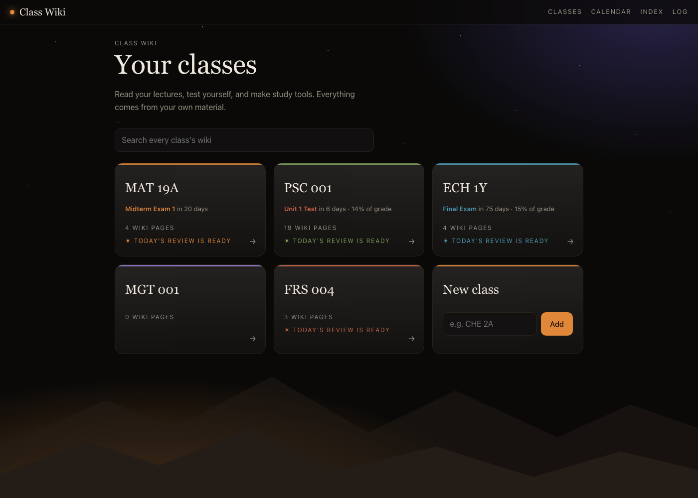
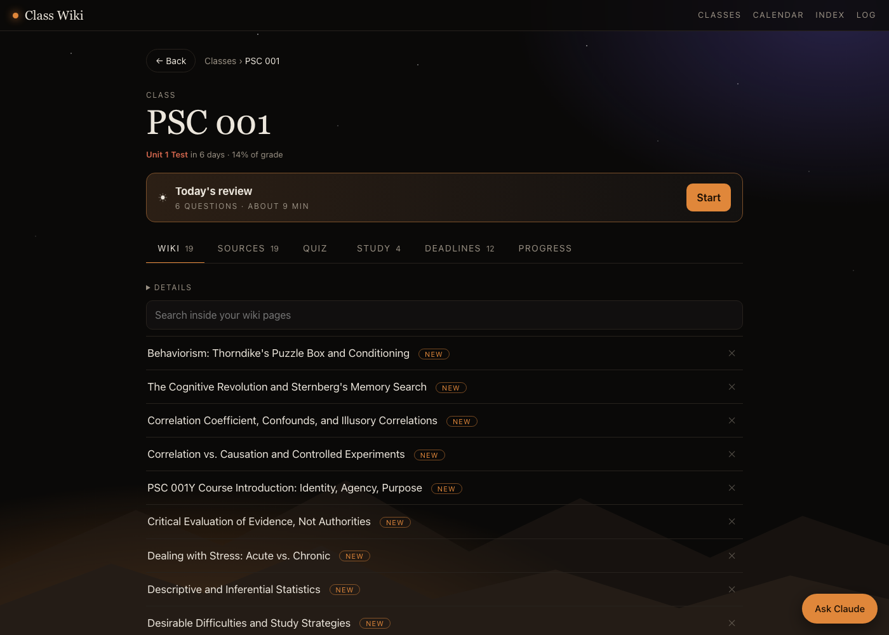
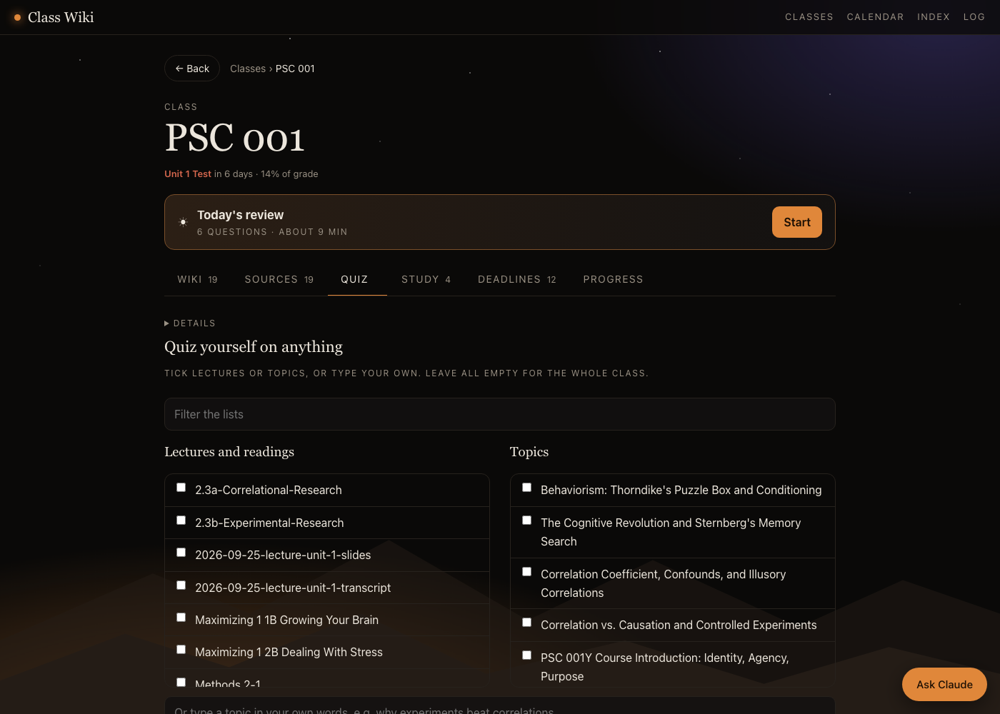
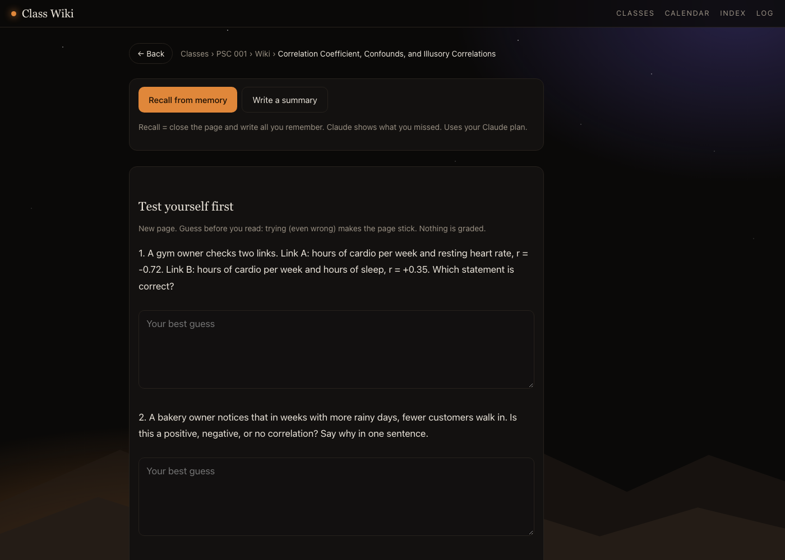
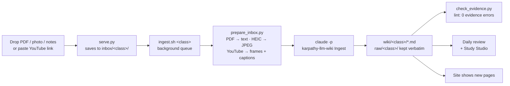

# Class Wiki

**Turn lectures, slides, whiteboard photos, and YouTube videos into a fact-checked study wiki for every class. It runs on your own Mac at $0, and you can open it on your phone through Tailscale.**


Class Wiki is a local, NotebookLM-style workspace. You add a class, drop in your sources, and Claude writes an interlinked markdown wiki from them. The wiki follows [Andrej Karpathy's LLM-wiki pattern](https://github.com/Astro-Han/karpathy-llm-wiki). Every fact on a page must quote the source it came from, and an automatic checker tests this after each ingest. From the wiki, one command makes quizzes, flashcards, slides, audio overviews, mind maps, and exam prep.

<p align="center">
  
  
  
  
</p>

---

## Features

| | |
|---|---|
| **Classes** | Each class gets its own area, like a NotebookLM notebook. Add one from the home page. |
| **Any source** | PDFs (screenshots inside them are read too), typed notes (`.txt` / `.md`), photos including iPhone HEIC, and YouTube links. |
| **Scanned PDFs & photos** | Text PDFs go through `pdftotext`. Scans, whiteboard photos, and handwriting are transcribed by Claude. |
| **YouTube** | Uses the `watch` skill. It reads the frames for the board and slides, plus the captions. Claude writes on-screen notes and keeps the full transcript. |
| **Auto-ingest** | Dropping a file starts a background ingest (one at a time). New pages appear without a reload. |
| **Merges, never duplicates** | A new source updates the pages that already exist. When sources disagree, the claim is marked **Disputed**. When a fact is replaced, it is marked **Outdated**. History is never silently rewritten. |
| **Grounded** | Every page links to its raw source. `check_evidence.py` confirms that each quoted fact appears word for word in the source. |
| **Math** | LaTeX renders with KaTeX. It is vendored, so it works offline. |
| **Daily review** | Each morning, one short quiz per class (15 min at most, never padded): pages due for review (spaced repetition), a few new pages, and missed questions asked a new way. No question is ever repeated. New pages come faster when an exam is near. |
| **Past test questions** | Upload old test or Canvas quiz questions (screenshots in a PDF work). Each question is filed under the concept it tests, and those concepts get more practice in your quizzes, asked the way your teacher asks. Wrong answer choices never become facts. |
| **Quiz tab** | Tick lectures, readings or topics, or type your own, and make a quiz on just that. |
| **Study Studio** | Quizzes, flashcards, slides, a 2-host audio overview, video, mind map, reports, comparison tables, and exam prep. One click each on the class page (**Study tools**), with a **Stop** button while it runs, or `/study` in Claude Code. Every output cites its wiki page. |
| **Weak spots** | Every quiz and flashcard answer is saved per wiki page. The class page lists your 5 weakest pages, and exam prep spends more time on them. |
| **Sources** | A dropdown with every source by name, plus full-text search inside all of them. |
| **Any device** | Open it on your phone or iPad through your own private Tailscale network. It is never on the public internet. |
| **Retry** | A file that could not be read is kept, not lost. The page shows ✗ and a **Retry failed** button. |

## How it works



1. **Upload.** The site saves your file to `inbox/<class>/` and queues an ingest for that class.
2. **Convert.** `prepare_inbox.py` turns each upload into markdown. A PDF original moves to `raw/<class>/files/` and a photo is deleted, but only after its notes are written, so a failure never loses a file. Claude gives each photo a readable title.
3. **Ingest.** Headless Claude (`claude -p`, Sonnet, low effort) follows the upstream wiki rules. It saves the source unchanged to `raw/`, then creates or merges topic pages in `wiki/<class>/`, and updates `wiki/index.md` and `wiki/log.md`.
4. **Lint.** The evidence checker confirms that every quoted claim is in its raw source.

Claude runs through the `claude` CLI that is already logged in on your Mac. It uses your Claude subscription, **not** a paid API key.

## Quick start

**Requirements:** macOS, Python 3.9+, and a logged-in [Claude Code](https://claude.com/claude-code) CLI. Install the rest from Homebrew:

```bash
brew install poppler yt-dlp ffmpeg   # pdftotext, YouTube, video
```

Docker is optional. It is only needed for the Kokoro audio voices, and without it the audio falls back to macOS `say`.

**Run the site:**

```bash
git clone https://github.com/ethankwyap-stack/class-wiki-public.git
cd class-wiki
python3 serve.py            # → http://localhost:4323
```

**Keep it running (optional).** A LaunchAgent can start it at login. Give it a `PATH` that includes `~/.local/bin` (for `claude`) and `/opt/homebrew/bin`, because launchd starts with a minimal environment. Then restart it with:

```bash
launchctl kickstart -k gui/$(id -u)/com.ethanyap.class-wiki
```

## Usage

### On the site

1. Open **http://localhost:4323** and add a class, for example `MAT 19A`.
2. On the class page:
   - Drag in **PDFs, notes, or photos**. For iPhone photos, AirDrop them to the Mac first.
   - Paste a **YouTube link** and click **Add**.
3. Wait for "Reading your sources…" to finish. Your new pages appear under **Wiki pages**.

### On your phone (Tailscale)

[Tailscale](https://tailscale.com) is a free private network between your own devices. Install it on the Mac and the phone and sign in to the same account. Then run this once on the Mac:

```bash
tailscale serve --bg --https=4323 http://127.0.0.1:4323
```

Open `https://<your-mac>.<tailnet>.ts.net:4323` on the phone. The Mac must be on and awake. Turn it off with `tailscale serve --https=4323 off`.

### From the command line

```bash
./ingest.sh mat-19a          # convert + ingest everything in inbox/mat-19a/
python3 prepare_inbox.py mat-19a   # convert only
```

`ingest.sh` also picks up `~/Downloads/lecture-<class>-*.md` transcripts. It is safe to run while the site is ingesting: a lock makes the second run wait its turn.

### Study Studio

On the class page, type an optional topic and click a **Study tools** button. The site runs `./study.sh <class> <kind> [topic]` in the background, one job at a time. Or run these inside Claude Code from the project root:

| Command | Output |
|---|---|
| `/study quiz <class> [topic]` | Interactive quiz (MCQ + short answer) |
| `/study cards <class> [topic]` | Flip flashcards |
| `/study slides <class> [topic]` | Marp slide deck |
| `/study audio <class> [topic]` | 2-host audio overview (Kokoro TTS in Docker) |
| `/study video <class> [topic]` | Slides + audio as an MP4 |
| `/study map <class> [topic]` | Markmap mind map (zoom, fold, click) |
| `/study report <class> <kind>` | Study guide, briefing, or cheat sheet |
| `/study table <class> "<question>"` | Comparison table |
| `/study exam <class>` | Exam prep built from your real exam dates |

Options: `--length short|normal|long`, `--audience "<who>"`, `--focus "<topic>"`. Outputs go to `studio/<class>/<kind>/`, and `studio/<class>/index.html` lists them.

## Project layout

```
class-wiki/
├── serve.py                 # local site + upload API (Python stdlib only)
├── prepare_inbox.py         # PDF / photo / YouTube → markdown
├── ingest.sh                # convert → ingest → lint, per class (makes no quizzes)
├── study.sh                 # one /study command, headless (the Study tools buttons)
├── classes.json             # [{slug, name}]
├── site/                    # single-page viewer; vendored marked + KaTeX
├── inbox/<class>/           # uploads waiting to be read (git-ignored)
├── raw/<class>/             # immutable sources (one .md each); PDF originals in files/
├── wiki/<class>/            # the generated wiki, plus wiki/index.md and wiki/log.md
├── studio/<class>/          # quizzes, cards, slides, audio, …
├── .claude/skills/
│   ├── karpathy-llm-wiki/   # upstream wiki rules (vendored, unmodified)
│   └── study-studio/        # /study commands + scripts + tests
├── overlap.py               # lists wiki pages that repeat each other (ingest lint)
├── tests/                   # site, API, conversion, overlap tests
└── docs/                    # PLAN.md, screenshots, old handoffs
```

## Security

The site is built for one person on one machine:

- **Local only.** It binds to `127.0.0.1`, so other devices on your network cannot reach it. To use it from your phone, put it on your own Tailscale network (never public) with `tailscale serve --bg --https=4323 http://127.0.0.1:4323`. The server accepts this Mac's own tailnet name and no other.
- **DNS-rebinding guard.** It rejects any request whose `Host` is not `localhost`, `127.0.0.1`, or this Mac's own tailnet name.
- **CSRF guard.** Every write must carry the header `X-Class-Wiki: 1`. A browser must ask permission (a CORS preflight) before another website can send that header, and this server never grants it.
- **Allow-listed reads.** Only `wiki/`, `raw/`, `studio/`, and `site/` are served. Code, config, and the inbox return 404.
- **Safe uploads.** File names are sanitized, types are allow-listed, size is capped at 500 MB, and files are never overwritten. YouTube links are checked by host name.
- **Constrained Claude.** Headless runs may only read and write files in the project. They have no shell and cannot delete files.
- **Sandboxed third-party code.** The upstream skill was vetted in Docker with `--network none`. Kokoro TTS only ever runs inside a container with no network.

## Testing

```bash
python3 -m unittest discover tests                            # site + conversion + overlap (52 tests)
cd .claude/skills/study-studio && python3 -m unittest discover tests   # study tools (36 tests)
python3 .claude/skills/karpathy-llm-wiki/scripts/check_evidence.py .    # wiki lint → 0 evidence errors
```

All tests use only the standard library. Claude and yt-dlp are stubbed, so the suite runs offline in seconds.

## Credits

- [karpathy-llm-wiki](https://github.com/Astro-Han/karpathy-llm-wiki) by Astro-Han, MIT. It provides the ingest, query, and lint rules, and is vendored unmodified at `eafcc77`.
- [marked](https://github.com/markedjs/marked) 15.0.12, MIT, and [KaTeX](https://katex.org) 0.16.22, MIT. Both are vendored in `site/`.
- [kokoro-onnx](https://github.com/thewh1teagle/kokoro-onnx) 0.6.1, MIT. It provides the local text-to-speech for audio overviews.
- [yt-dlp](https://github.com/yt-dlp/yt-dlp), [Poppler](https://poppler.freedesktop.org), and [FFmpeg](https://ffmpeg.org).
